&nbsp;
&nbsp;

 

  

  

  

<!-- Yeh image tab dikhegi jab "Profile 3D Contrib" workflow ek baar chal jaye -->

  

<table>
<tr>
<td width="50%"></td>
<td width="50%"></td>
</tr>
<tr>
<td width="50%"></td>
<td width="50%"></td>
</tr>
</table>

 

 

<picture>
  <source media="(prefers-color-scheme: dark)" srcset="https://raw.githubusercontent.com/Zenith-CoderX/Zenith-CoderX/output/github-snake-dark.svg"/>
  
</picture>

  

<!-- Apna LinkedIn / Email yahan lagayein:

-->

